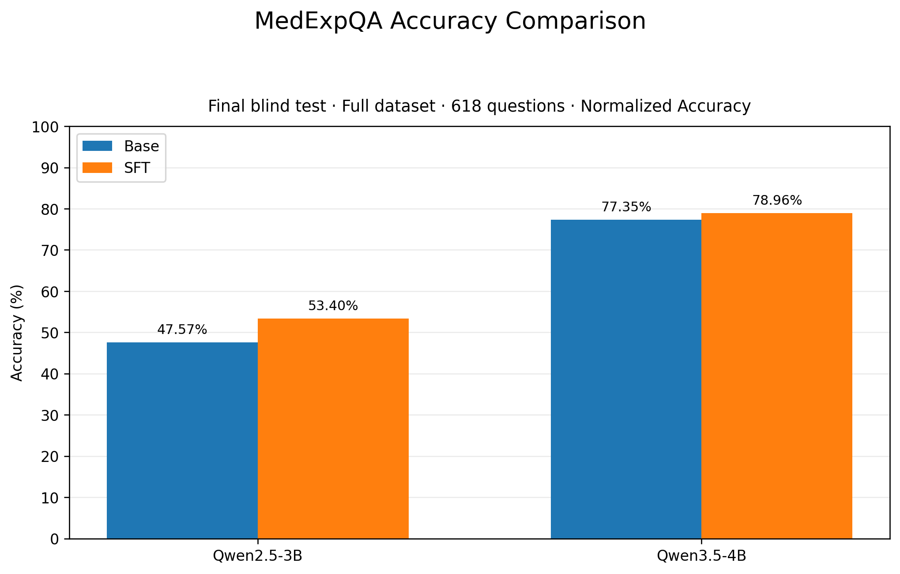

# Qwen Medical SFT

比较 Qwen2.5-3B-Instruct 和 Qwen3.5-4B 在 MedMCQA 医学选择题上做 LoRA 监督微调前后的表现。[试用 Qwen2.5](#试用-qwen25)

## 最终盲测结果



| 模型 | 最终盲测集 | Base Accuracy | SFT Accuracy | 变化 |
| --- | --- | ---: | ---: | ---: |
| Qwen2.5-3B-Instruct | MedMCQA | 47.98% | 50.44% | **+2.46 pp** |
| Qwen2.5-3B-Instruct | MedExpQA | 47.57% | 53.40% | **+5.83 pp** |
| Qwen3.5-4B | MedMCQA | 62.13% | 64.02% | **+1.89 pp** |
| Qwen3.5-4B | MedExpQA | 77.35% | 78.96% | **+1.61 pp** |

MedMCQA 使用官方 Validation（4,183 题），MedExpQA 使用全集（618 题）。两套数据均用于最终盲测，均未用于该轮模型筛选。表中采用 Normalized Accuracy，以全部题目为分母，无效答案计错。`pp` 表示百分点。

[完整成绩与评估配置](reports/results/final_accuracy_results_20261117.md) · [结果 CSV](reports/results/final_accuracy_results_20261117.csv)

## 快速开始

### 试用 Qwen2.5

**Built with Qwen**。用同一道医学选择题依次查看基座模型和加载最后一步 LoRA 适配器后的原始回答。默认沿用训练提示词，请模型给出选项（`Answer`）和简短英文解释（`Explanation`）。加 `--answer-only` 可切换到盲测时使用的单行作答提示词。

```bash
git clone https://github.com/wqy0813/qwen-medical-sft.git
cd qwen-medical-sft
python -m pip install torch "transformers==5.20.1" "peft==0.21.2"
python scripts/try_qwen25.py
```

首次运行从 Hugging Face 下载指定版本的基座权重（约 6.2 GB），后续运行使用缓存。脚本优先使用 CUDA，也支持 CPU。适配器随仓库提供，供非商业研究与评估使用。[适配器与许可](release/qwen25-3b-final-lora/)

使用自己的英文题目时，按顺序提供四个或五个选项。已有该版本基座的本地副本时，可加 `--base-dir 路径` 离线运行。

```bash
python scripts/try_qwen25.py --question "Which blood cells carry oxygen?" --options "Platelets" "Red blood cells" "Neutrophils" "Lymphocytes"
```

### 重绘准确率图

使用仓库自带的成绩 CSV 在 CPU 上重绘两张准确率对比图。

```bash
git clone https://github.com/wqy0813/qwen-medical-sft.git
cd qwen-medical-sft
python -m pip install numpy matplotlib
python scripts/plot_accuracy_comparison.py
```

生成的图位于 [`reports/figures/accuracy/`](reports/figures/accuracy/)。

### 运行公开测试

106 项公开测试可在 CPU 上运行，无需下载模型权重或恢复冻结数据。在仓库根目录使用 Python 3.12。下面的命令使用 Windows PowerShell。

```powershell
python -m venv .venv
.\.venv\Scripts\python.exe -m pip install torch --index-url https://download.pytorch.org/whl/cpu
.\.venv\Scripts\python.exe -m pip install numpy transformers pyarrow
.\.venv\Scripts\python.exe -m pip install -e .
.\.venv\Scripts\python.exe scripts/run_tests.py public
```

在 Linux 和 macOS 上，虚拟环境的解释器路径为 `.venv/bin/python`。按平台选择 CPU 版 PyTorch 的安装命令。[PyTorch 官方安装说明](https://pytorch.org/get-started/locally/)

## 实验资料

- MedMCQA 清洗输入为 **173,683 条**，最终训练集有 **137,928 条**。[数据划分与清洗](data/README.md)
- 两款模型均采用 BF16 LoRA，使用 Answer + Explanation 作为监督目标，Loss 仅在 Assistant 目标上计算。[训练配置](configs/medmcqa_only_training/)
- 数据处理、训练、评估和测试的代码入口见[项目文件索引](PROJECT_FILE_INDEX.md)。
