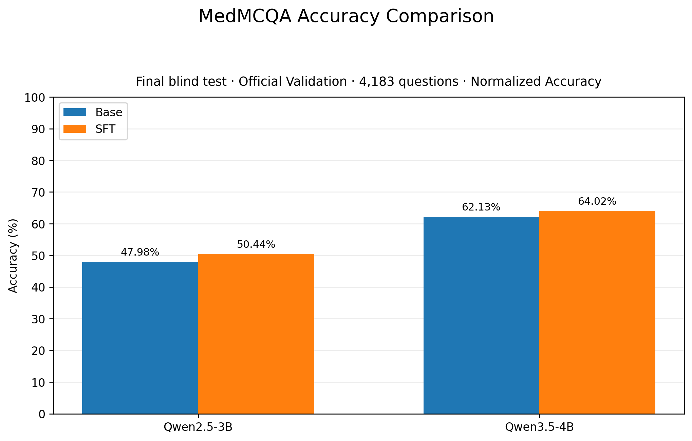
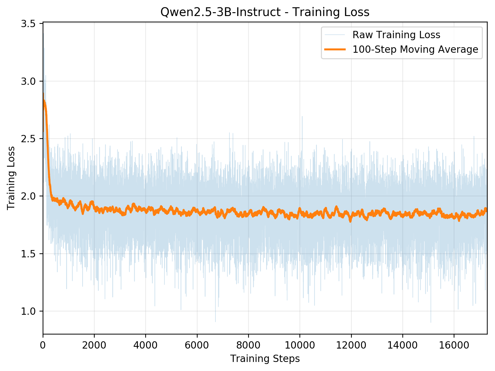
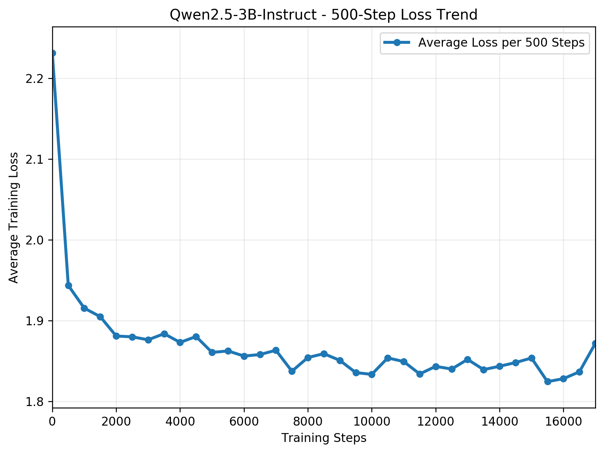
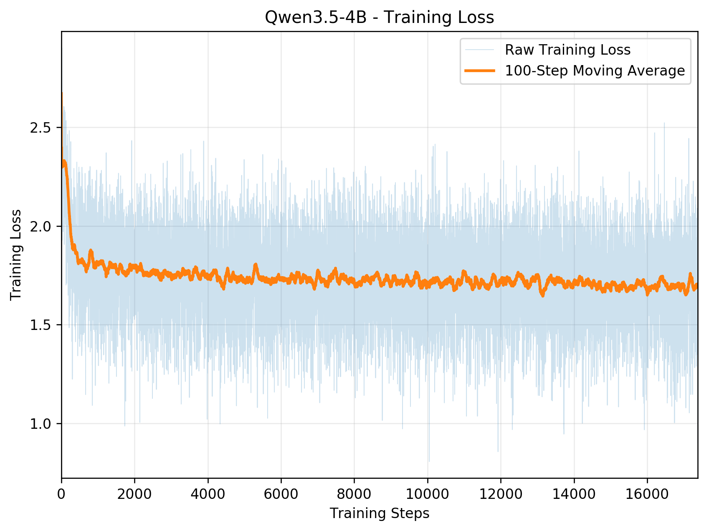
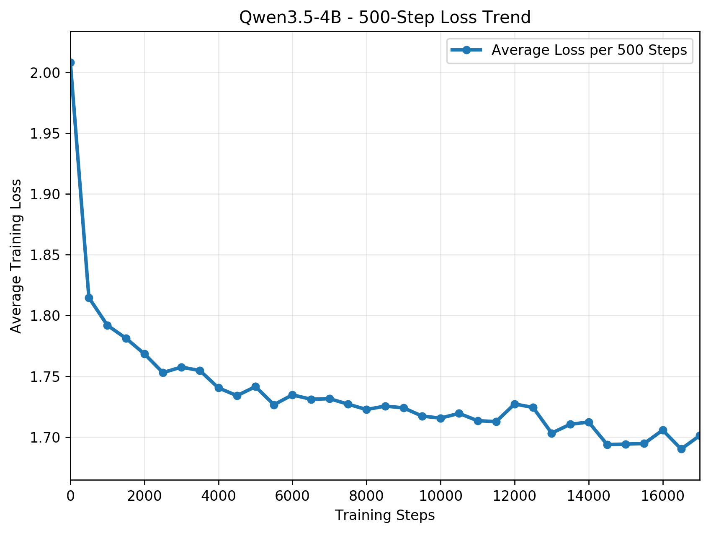

# Qwen Medical SFT

**基于 MedMCQA 的 Qwen 医学领域监督微调与效果评估**

本项目使用 MedMCQA 医学选择题数据集，对 Qwen2.5-3B-Instruct 和 Qwen3.5-4B 两个开源指令模型进行 LoRA 监督微调（SFT），并通过 MedMCQA Official Validation 和 MedExpQA 评估模型微调前后的医学问答表现。

项目主要关注：**在相同训练数据和核心微调方案下，不同基础模型经过医学领域 SFT 后，性能会产生怎样的变化？**

## 核心实验结果

本项目完成了两个模型的训练与评估。下表使用 Normalized Accuracy，变化量按表中展示的百分比计算。完整明细见[四模型准确率结果汇总](reports/results/final_accuracy_results_20261117.md)。

| 模型         | 评估数据集    | Base Accuracy | SFT Accuracy | 变化           |
| ---------- | -------- | ------------- | ------------ | ------------ |
| Qwen2.5-3B | MedMCQA  | 47.98%        | 50.44%       | **+2.46 pp** |
| Qwen2.5-3B | MedExpQA | 47.57%        | 53.40%       | **+5.83 pp** |
| Qwen3.5-4B | MedMCQA  | 62.13%        | 64.02%       | **+1.89 pp** |
| Qwen3.5-4B | MedExpQA | 77.35%        | 78.96%       | **+1.61 pp** |

**主要发现：**

- Qwen2.5-3B-Instruct 经过 SFT 后，在两个评估数据集上均取得准确率提升。
- Qwen3.5-4B 在 MedMCQA 和 MedExpQA 上有小幅提升。
- Qwen3.5-4B 的 Base 模型在两个评估数据集上均具有更高的初始准确率。

## 1. 项目介绍

### 1.1 研究背景

随着开源大语言模型的发展，小参数量模型在本地部署和专业领域应用中受到越来越多关注。然而，受限于模型规模和计算资源，小模型在专业知识掌握和复杂任务处理方面仍面临一定挑战。

尤其在医学领域，模型不仅需要理解专业术语，还需要具备准确的医学知识和可靠的问答能力。因此，如何利用有限的训练资源改善小参数量模型在特定专业领域的表现，是一个值得探索的问题。

### 1.2 研究目标

本项目希望探索以下问题：

**利用公开医学问答数据进行监督微调，能否改善不同基础模型在医学问答任务上的表现？不同基础模型经过相同训练数据和核心微调方案后，其性能提升是否一致？这种变化能否在不同来源的评估数据上得到体现？**

围绕这一研究问题，本项目重点关注三个方面：

1. **数据构建：** 如何对公开医学问答数据进行规范化、质量检查和训练适配，构建适合 SFT 的医学问答训练集。
2. **参数高效微调：** 如何利用 LoRA 等参数高效微调技术，在有限计算资源条件下完成医学领域适配。
3. **效果验证：** 不同基础模型经过相同训练方案后，医学问答准确率产生怎样的变化，以及这种变化在不同评估数据上的表现是否一致。

### 1.3 项目亮点

围绕上述目标，本项目完成了以下工作：

- **医学训练数据构建：** 基于 MedMCQA 公开训练数据，实现数据规范化、答案与选项检查、重复数据处理、安全修复、异常样本隔离和 Tokenizer 长度审计，最终构建统一的医学 SFT 训练集。
- **参数高效微调：** 采用 LoRA 对 Qwen2.5-3B-Instruct 和 Qwen3.5-4B 两个基础模型开展医学领域监督微调。
- **多数据集评估：** 使用 MedMCQA Official Validation 和 MedExpQA 全集，对两个模型的 Base 与 SFT 版本进行统一评估。
- **实验对比与分析：** 比较模型微调前后的 Accuracy 和 Training Loss，分析不同基础模型在不同医学评估数据上的性能变化。

本项目旨在探索公开医学问答数据与参数高效微调相结合的可行性，并分析不同基础模型在相同训练条件下的微调效果差异。

---

## 2. 实验设计（Experimental Setup）

本项目采用对比实验的方式，研究医学领域监督微调对不同基础模型的影响。

实验选择两个不同规模的 Qwen 指令模型，分别进行 LoRA SFT，并将微调后的模型与各自的 Base 模型进行比较。

### 2.1 实验对象

本项目选取以下两个开源基础模型：

|模型|参数规模|实验角色|
|---|---|---|
|Qwen2.5-3B-Instruct|3B|基础模型及 SFT 模型|
|Qwen3.5-4B|4B|基础模型及 SFT 模型|

每个基础模型均保留 Base 和 SFT 两个版本，最终形成四个待评估模型。

### 2.2 实验数据

实验使用一个医学问答训练数据集和两个评估数据集：

|数据集|数据规模|用途|
|---|---|---|
|MedMCQA Official Train|182,822 条|原始训练数据来源|
|MedMCQA Official Validation|4,183 条|最终评估|
|MedExpQA|618 条|不同来源的医学问答评估|

两个模型使用相同的 MedMCQA 最终训练数据，MedExpQA 不参与 SFT 训练。

### 2.3 对比实验设计

本项目主要采用两组对照：

- **模型内对比：** 分别比较 Qwen2.5-3B-Instruct 和 Qwen3.5-4B 微调前后的准确率变化。
- **跨模型对比：** 比较两个基础模型在相同训练数据和核心微调方案下的表现差异。

为保证实验条件一致，两个模型使用相同的训练样本、样本顺序和核心 SFT 配置，并采用统一的评估指标和评估数据。

主要评价指标为 **Accuracy（准确率）**，通过 Base 与 SFT 的准确率变化衡量微调效果。

### 2.4 整体实验流程

整个实验分为数据准备、模型微调和效果评估三个阶段：

```
              MedMCQA
                  │
                  ▼
             数据处理
                  │
                  ▼
        最终训练集 137,928 条
                  │
                  ▼
              LoRA SFT
                  │
          ┌───────┴───────┐
          ▼               ▼
     Qwen2.5-3B       Qwen3.5-4B
          │               │
       Base / SFT      Base / SFT
          │               │
          └───────┬───────┘
                  │
                  ▼
              统一评估
                  │
          ┌───────┴───────┐
          ▼               ▼
       MedMCQA         MedExpQA
        4,183             618
          │               │
          └───────┬───────┘
                  ▼
             Accuracy
             对比分析
```

---

## 3. 数据集与数据处理（Data Preparation）

本项目使用 **MedMCQA** 作为主要 SFT 训练数据，并使用 MedMCQA Official Validation 和 MedExpQA 对训练后的模型进行评估。

本部分主要介绍数据来源、数据划分，以及原始训练数据如何经过清洗和长度检查，最终形成可用于 SFT 的训练数据。

### 3.1 MedMCQA 数据集

MedMCQA 是本项目的主要医学问答训练数据集，包含医学领域的选择题、候选选项、标准答案及解释。

本项目使用其官方 Train 数据作为原始训练来源。

由于官方 Test 集不公开答案标签，无法直接计算其 Accuracy，因此本项目采用官方 Validation 集作为最终可量化评估集。

MedMCQA 清洗输入为 **173,683 条**，按官方 Train 的 **182,822 条**扣除 **9,139 条**内部验证样本计算。划分按规范化题干分组，随机种子为 `20261020`，同一题干分组整体分配到训练侧或内部验证侧。

数据划分及最终使用情况如下：

| 数据角色                        | 数量               | 用途           |
| --------------------------- | ---------------- | ------------ |
| 官方 Train 原始数据               | 182,822          | 原始训练来源       |
| 清洗输入                        | 173,683          | 数据清洗与长度筛选的起始统计数量 |
| 内部验证集                       | 9,139            | 训练监控与内部验证    |
| 最终 SFT 训练集                  | **137,928 / 模型** | 两个模型使用相同训练数据 |
| MedMCQA Official Validation | 4,183            | 最终评估         |

#### 数据处理流程

下图按样本数量展示清洗和长度筛选流程。清洗输入到最终训练集的差额包含划分前预筛剔除的 35 条记录（4 条答案冲突、31 条重复题）。

```
MedMCQA Official Train
        │
        ▼
   题干规范化
        │
        ▼
按规范化题干固定分组
        │
        ├──────────────┐
        ▼              ▼
      清洗输入        内部验证集
    173,683            9,139
        │
        ▼
      数据清洗
        │
        ├─ 文本格式规范化
        ├─ 答案与选项检查
        ├─ 重复数据检查
        ├─ 可安全修复的问题进行修复
        └─ 无法安全处理的样本隔离
        │
        ▼
   Tokenizer / Processor
       长度检查
        │
        ▼
  最终 SFT 训练集
    137,928 条
```

#### 数据清洗与训练准入

**1. 文本格式规范化**

对题目、选项和解释等文本进行统一规范化，用于后续的一致性判断和重复检查，主要包括：
- Unicode NFKC 规范化；
- 去除首尾无效空白；
- 合并连续空白；
- 使用 `casefold` 进行大小写规范化。

该过程主要用于统一文本表示，不改变题目的医学内容。

**2. 答案与选项检查**

对原始答案字段进行统一解析，并转换为 **A/B/C/D** 形式，同时检查答案是否有效以及与题目选项是否一致。

对于可以明确修复的格式问题进行修复；对于答案冲突、选项异常等无法安全判断的情况，不猜测答案，而是将样本隔离。

**3. 重复数据检查**

对规范化后的题干、选项和答案进行重复检查，处理原则为：
- 完整内容重复的记录只保留一份；
- 相同题目、相同选项和相同答案，但解释不同的记录予以保留；
- 相同题目和选项出现不同答案时，视为答案冲突并隔离；
- 不根据语义相似度自动删除题目。

这样既可以减少明确的重复数据，又能避免因为题目语义相似而误删有效训练样本。

**4. 安全修复与样本隔离**

对于确定不会改变题目含义的格式问题进行修复，例如空白或部分文本格式问题。

修复过程中遵循以下原则：
- 不修改 Gold Answer；
- 不人工生成医学解释；
- 不根据医学知识猜测缺失内容。

对于无法安全修复或不满足训练条件的样本，则进行隔离，不进入最终训练数据。

**5. Tokenizer / Processor 长度检查**

数据清洗完成后，使用两个模型各自对应的 Tokenizer / Processor 对训练候选进行全量长度检查。

最大序列长度设置为 **512 Tokens**：
- 不超过 512 Tokens 的样本通过长度检查；
- 超过 512 Tokens 的样本进行隔离；
- 不进行静默截断；
- 长度按照实际 Tokenizer / Processor 的结果计算，而不是使用字符数估算。

经过上述数据处理和训练准入检查后，最终得到 **137,928 条 / 模型**的 SFT 训练数据。

两个模型使用完全相同的 137,928 条训练样本及相同顺序，保证后续模型比较具有一致的数据基础。

### 3.2 MedExpQA 数据集

MedExpQA 用于最终模型评估。本项目使用其完整的 **618 条数据**。

|上游 split 来源|数量|本项目用途|
|---|---|---|
|Train|430|评估|
|Validation|63|评估|
|Test|125|评估|
|**合计**|**618**|**完整评估集**|

这里的 Train / Validation / Test 是 MedExpQA 原始数据中的来源标签。本项目将三个 split 合并后作为完整评估集使用。

**MedExpQA 全集未参与两个模型的 SFT 训练。**

与 MedMCQA 训练数据不同，MedExpQA 在本项目中仅作为最终评估数据使用，不参与 SFT 训练数据的构建，也不套用训练数据的长度准入流程。

---

## 4. SFT 训练方法（SFT Methodology）

在完成训练数据构建后，本项目采用监督微调（Supervised Fine-Tuning，SFT），使基础模型学习医学问题的答案生成与解释能力。

两个模型使用相同的训练样本、样本顺序和核心训练方案，采用 BF16 基座模型与 LoRA 相结合的方式完成微调。

### 4.1 训练目标与数据组织

本项目采用 **Answer + Explanation** 作为监督目标，即模型不仅需要给出医学选择题的正确答案，还需要生成对应的解释。

训练数据组织为以下形式：

|组成部分|内容|训练作用|
|---|---|---|
|Prompt|医学问题及候选选项|作为模型输入|
|Answer|标准答案|监督模型生成正确选项|
|Explanation|对应答案的解释|监督模型生成答案解释|

训练过程中：
- **Prompt** 部分作为模型输入；
- **Answer + Explanation** 作为监督目标；
- Loss 仅计算 Assistant 目标部分；
- Prompt 部分不参与 Loss 计算。

这种方式使模型在学习医学知识的同时，也学习根据问题和选项生成答案及解释。

### 4.2 LoRA 参数高效微调

本项目采用 **LoRA（Low-Rank Adaptation）** 进行参数高效微调。

与更新基座模型全部参数的传统微调方式不同，LoRA 冻结基座模型的大部分参数，在指定模块中引入可训练的低秩适配器，仅更新适配器参数，从而减少微调过程中的显存和计算开销。

本项目分别为两个基础模型训练 LoRA Adapter，并将其与 Base 模型分开保存。具体 LoRA 参数配置见下文。

### 4.3 训练配置

两个模型采用相同的核心训练方案，具体配置如下：

|配置项|设置|
|---|---|
|训练数据|MedMCQA，137,928 条 / 模型|
|微调方式|BF16 + LoRA|
|最大序列长度|512 Tokens|
|Micro Batch Size|2|
|Gradient Accumulation|4|
|Effective Batch Size|8|
|Learning Rate|5e-5|
|Epochs|1|
|Optimizer|AdamW|
|Scheduler|Linear|
|Warmup Steps|518|
|Random Seed|42|
|LoRA Rank|8|
|LoRA Alpha|16|
|LoRA Target Modules|`q_proj`, `v_proj`|
|LoRA Dropout|0|

其中：

**Effective Batch Size = Micro Batch Size × Gradient Accumulation = 2 × 4 = 8。**

Qwen3.5-4B 训练过程中关闭 thinking。

两个模型使用相同的训练数据、样本顺序和核心训练配置，以减少训练条件差异对实验结果的影响。

### 4.4 训练产物

正式训练完成后，每个模型均生成对应的训练产物：

- **LoRA Adapter：** 保存微调得到的适配器参数；
- **Training Checkpoints：** 保存训练过程中的模型检查点；
- **Training Loss Logs：** 记录逐 Step 训练损失；
- **Evaluation Predictions：** 保存模型在评估数据上的预测结果。

Base 模型与 LoRA Adapter 分开保存。评估时分别加载 Base 模型或对应 Adapter，构建 Base / SFT 两个版本进行对比。

---

## 5. 模型评估（Evaluation）

本项目通过统一评估流程，对两个基础模型的 Base 和 SFT 版本进行比较，观察医学领域监督微调前后的准确率变化。

### 5.1 评估对象

最终评估以下四个模型：

|基础模型|评估版本|
|---|---|
|Qwen2.5-3B-Instruct|Base / SFT|
|Qwen3.5-4B|Base / SFT|

其中，Base 使用原始基础模型，SFT 使用对应基础模型加载 LoRA Adapter 后的版本。

### 5.2 评估数据集

评估使用两个医学问答数据集：

|数据集|样本数量|评估目的|
|---|---|---|
|MedMCQA Official Validation|4,183|评估模型在训练数据同源任务上的表现|
|MedExpQA|618|评估模型在不同来源医学问答数据上的表现|

两个数据集均用于四个模型的统一评估。

### 5.3 评估指标与设置

本项目采用 **Accuracy（准确率）** 作为主要评价指标，计算模型预测正确的样本占全部评估样本的比例。

同时，通过比较 Base 和 SFT 的 Accuracy，衡量微调带来的性能变化：
$$
\Delta \text{Accuracy} = \text{Accuracy}_{\text{SFT}} - \text{Accuracy}_{\text{Base}}
$$

评估采用统一的生成配置：

|配置项|设置|
|---|---|
|Decoding|Greedy Decoding|
|Precision|BF16|
|Max New Tokens|32|
|Qwen3.5 Thinking|关闭|
|Evaluation Metric|Accuracy|

两个模型的 Base 和 SFT 版本均采用上述统一评估设置。

最终分别统计两个模型在 MedMCQA 和 MedExpQA 上的 Accuracy，并计算微调前后的准确率变化，用于后续实验结果对比与分析。

---
## 6. 实验结果与分析（Results and Analysis）

本项目分别在 MedMCQA Official Validation 和 MedExpQA 上评估四个模型，通过 Base 与 SFT 的 Accuracy 对比，分析医学领域监督微调带来的性能变化。

### 6.1 MedMCQA 评估结果

MedMCQA Official Validation 共包含 4,183 条样本，评估结果如下：

| 模型                  | Base Accuracy | SFT Accuracy | 变化           |
| ------------------- | ------------- | ------------ | ------------ |
| Qwen2.5-3B-Instruct | 47.98%        | 50.44%       | **+2.46 pp** |
| Qwen3.5-4B          | 62.13%        | 64.02%       | **+1.89 pp** |



两个模型经过 SFT 后，在 MedMCQA 上的准确率均有所提升。其中，Qwen2.5-3B-Instruct 提升 2.46 个百分点，Qwen3.5-4B 提升 1.89 个百分点。

### 6.2 MedExpQA 评估结果

MedExpQA 使用完整的 618 条样本，评估结果如下：

| 模型                  | Base Accuracy | SFT Accuracy | 变化           |
| ------------------- | ------------- | ------------ | ------------ |
| Qwen2.5-3B-Instruct | 47.57%        | 53.40%       | **+5.83 pp** |
| Qwen3.5-4B          | 77.35%        | 78.96%       | **+1.61 pp** |


在 MedExpQA 上，Qwen2.5-3B-Instruct 的准确率提升 5.83 个百分点，而 Qwen3.5-4B 的准确率提升1.61 个百分点。

这表明 SFT 带来的性能变化并不一定在不同评估数据上保持一致。

### 6.3 不同模型与评估数据上的表现差异

两个模型采用相同的训练数据和核心 LoRA 配置，但微调收益存在明显差异，可能受到基础模型初始能力、模型架构以及训练与评估数据分布差异等因素影响。

**1. 不同基础模型的微调收益不同**

Qwen2.5-3B-Instruct 的初始医学问答准确率相对较低（MedMCQA 47.98%，MedExpQA 47.57%），SFT 后分别提升 2.46 和 5.83 个百分点。同时，MedExpQA 上的无效答案从 49 条降至 3 条，说明微调还改善了答案输出规范性。

Qwen3.5-4B 的微调前准确率较高，在 MedMCQA 和 MedExpQA 上分别为 62.13% 和 77.35%。SFT 后，两个数据集上的准确率分别提升 1.89 和 1.61 个百分点。在相同训练数据和核心 LoRA 配置下，Qwen3.5-4B 在两个数据集上的提升幅度均小于 Qwen2.5-3B-Instruct。

**2. 不同评估数据上的表现存在差异**

MedMCQA 的训练集与官方 Validation 来自同一数据集，任务形式和数据分布具有较高一致性，因此两个模型在该数据集上均取得提升。

MedExpQA 包含来自 MIR 医学考试的临床病例和选择题，与 MedMCQA 在题目形式和数据分布上存在差异。在 MedExpQA 全集上，Qwen2.5-3B-Instruct 和 Qwen3.5-4B 微调后均有提升，准确率分别提高 5.83 和 1.61 个百分点。两个模型在不同来源的评估数据上均有收益，提升幅度有所不同。

**3. 综合分析**

实验表明，相同的医学 SFT 方案对不同基础模型的作用并不相同。Qwen2.5-3B 原有医学问答能力和答案输出规范性相对较弱，因此获得了更明显的微调收益；Qwen3.5-4B 已具备较强的基础能力，当前训练方案带来的额外收益相对有限。

这说明医学 SFT 的效果不仅取决于训练数据和微调配置，还受到基础模型能力、架构特点及训练与评估数据分布差异的共同影响，不能简单认为模型参数规模越大，微调收益就越明显。

### 6.4 训练损失曲线（Training Loss）

训练过程中记录逐 Step Training Loss，并根据训练日志绘制损失曲线，用于观察两个模型在 SFT 过程中的优化情况。

**Qwen2.5-3B-Instruct**





前两个 500 Step 区间的平均 Loss 从约 2.23 快速降至 1.94，随后下降放缓。中后期的 100 Step 移动平均逐渐稳定在 1.85 附近，Raw Loss 仍有逐 Step 波动。

**Qwen3.5-4B**





前两个 500 Step 区间的平均 Loss 从约 2.01 快速降至 1.81，中期下降速度放缓。后期区间平均 Loss 在 1.70 附近小幅波动，Raw Loss 仍有逐 Step 起伏。

**综合分析**

Raw Loss 的逐 Step 起伏是小批量训练中的正常波动。Training Loss 反映模型在训练数据上的优化过程，医学问答表现以独立评估集上的 Accuracy 为准。判断是否过拟合还需观察独立验证集上的表现如何随训练推进而变化。

---
## 7. 项目资源与运行说明（Project Resources）

本项目已完成正式训练与评估。核心代码、实验配置及结果文件按功能模块组织，便于查阅和后续实验复用。

|资源|路径|说明|
|---|---|---|
|数据处理|`src/medical_sft/data/`|数据清洗、划分与训练数据构建|
|模型训练|`src/medical_sft/training/`|LoRA SFT 训练实现|
|模型评估|`src/medical_sft/evaluation/`|Base / SFT 统一评估|
|实验配置|`configs/`|冻结的训练与评估配置|
|数据目录说明|[data/README.md](data/README.md)|数据来源、划分与评估范围|
|实验结果|`reports/results/`|最终评估结果|
|可视化图表|`reports/figures/`|Accuracy 与 Training Loss 图表|

项目依赖及构建配置见根目录 `pyproject.toml`，数据发布信息见 `data_release_manifest.json`。

如需在其他环境中运行相关流程，需要准备对应的数据集、基础模型及依赖环境，并参考项目中的冻结配置执行。

---

## 8. 项目结构（Project Structure）

项目采用模块化目录组织，将数据处理、模型训练、模型评估、实验配置和结果产物分开管理。

```
qwen-medical-sft/
├── configs/                    # 冻结的训练与评估配置
│
├── data/
│   ├── raw/                    # 原始数据
│   ├── processed/              # 正式处理后的数据
│   └── evaluation/             # 评估数据
│
├── models/                     # 基础模型
│
├── outputs/                    # 训练与评估产物
│
├── reports/
│   ├── results/                # 最终实验结果
│   └── figures/
│       ├── accuracy/           # Accuracy 对比图
│       └── training_loss/      # Training Loss 曲线
│
├── src/
│   └── medical_sft/
│       ├── data/               # 数据处理代码
│       ├── training/           # 模型训练代码
│       └── evaluation/         # 模型评估代码
│
├── tests/                      # 项目测试
├── scripts/                    # 绘图及辅助脚本
│
├── data_release_manifest.json  # 数据发布清单
├── pyproject.toml              # Python 项目配置
├── PROJECT_FILE_INDEX.md       # 项目文件索引
└── README.md                   # 项目说明文档
```

### 主要目录说明

| 目录 / 文件                      | 主要内容                                  |
| ---------------------------- | ------------------------------------- |
| `src/medical_sft/`           | 项目的正式业务代码，包括数据处理、训练和评估模块              |
| `configs/`                   | 最终冻结的训练与评估配置                          |
| `data/`                      | 原始数据、处理后的训练数据及评估数据                    |
| `models/`                    | Qwen2.5-3B-Instruct 和 Qwen3.5-4B 基础模型 |
| `outputs/`                   | LoRA Adapter、训练 Checkpoint、日志及评估产物    |
| `reports/`                   | 最终实验结果及可视化图表                          |
| `tests/`                     | 项目自动化测试                               |
| `scripts/`                   | 绘图及其他辅助脚本                             |
| `data_release_manifest.json` | 数据发布清单                                |
| `pyproject.toml`             | 项目依赖与构建配置                             |
| `PROJECT_FILE_INDEX.md`      | 项目文件索引与说明                             |

项目采用 `src/medical_sft/` 作为正式代码目录，将核心业务逻辑与配置、数据、实验产物分离，便于维护和后续扩展。
